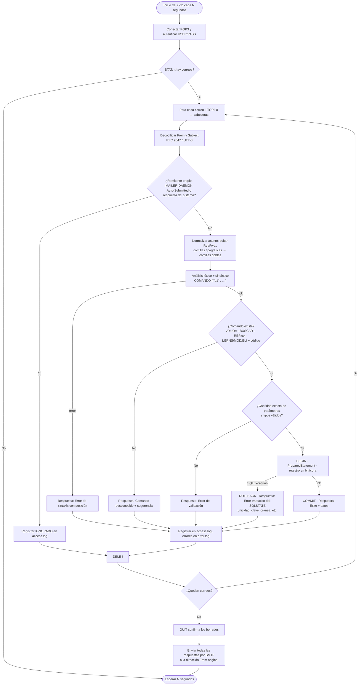
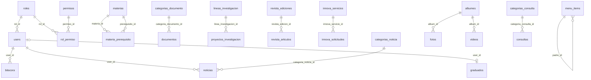

# INF513 · Proyecto #1 · Sistema basado en correo electrónico (Email-Driven Architecture)

**Universidad Autónoma Gabriel René Moreno (UAGRM)** · FICCT · INF513 Tecnología Web · Gestión 2026-2
**Grupo 23SA** · Casilla `grupo23sa@tecnoweb.org.bo` · Base de datos `db_grupo23sa`

Backend que administra los datos de la **Página Web de la Carrera de Administración de Empresas** usando
únicamente correo electrónico: el usuario escribe un comando en el **Asunto** (por ejemplo
`LISUSU["*"]` o `INSMAT["ADM-300","Administración II","3","5","4","2","obligatoria",""]`), el sistema lo
valida, lo ejecuta en PostgreSQL y responde automáticamente con un correo de **Éxito** (con los datos) o
de **Error** (con la descripción del fallo).

---

## Probar directamente con Tecnoweb

Esta es la prueba real: el programa lee los comandos de la casilla Tecnoweb, consulta la base de datos Tecnoweb y manda la respuesta por Gmail, según la configuración actual. Ejecuta los comandos desde una terminal abierta en la carpeta del proyecto.

### 1. Revisar `config.properties`

Confirma estos valores, sin compartir el archivo ni publicar contraseñas:

- `pop3.*`: usuario y contraseña de la casilla Tecnoweb; host `mail.tecnoweb.org.bo`, puerto `110`.
- `correo.buzon`: dirección Tecnoweb a la que vas a mandar los comandos.
- `bd.*`: host `db.tecnoweb.org.bo`, puerto `5432`, base, usuario y contraseña asignados al grupo.
- `smtp.*`: Gmail para enviar respuestas: host `smtp.gmail.com`, puerto `465`, `smtp.ssl=true`, `smtp.auth=login`. En `smtp.usuario` y `smtp.remitente` va tu dirección Gmail; en `smtp.password`, su contraseña de aplicación.

Deja un solo bloque activo de valores `smtp.*` para que sea fácil ver cuál se está usando.

### 2. Compilar

```bash
./compilar.sh
```

Debe aparecer `OK -> dist/inf513-proyecto1.jar`. Si aparece `javac` no encontrado, instala un JDK 8 o superior.

### 3. Probar las conexiones

```bash
./ejecutar.sh diagnostico
```

Continúa cuando veas `[BD] OK`, `[POP3] OK` y `[SMTP] OK`. En `[BD]`, confirma también que estén las tablas del proyecto. Este diagnóstico no manda ni borra correos.

### 4. Confirmar que Gmail puede enviar

```bash
./ejecutar.sh enviar-prueba TU_CORREO_DE_DESTINO
```

Reemplaza `TU_CORREO_DE_DESTINO` por una dirección que puedas revisar. Este comando manda un correo real. Continúa cuando lo recibas.

### 5. Iniciar el lector de correos

En una terminal, ejecuta:

```bash
./ejecutar.sh demonio
```

Deja esta terminal abierta. El programa revisa la casilla Tecnoweb cada pocos segundos.

### 6. Mandar el comando de prueba

Desde otra cuenta, manda un correo a la dirección de Tecnoweb configurada en `correo.buzon`. Pon este texto como **asunto**:

```text
LISMAT["*"]
```

El programa debe leer el mensaje, consultar las materias en PostgreSQL y responder a la dirección que lo envió. También puedes probar la ayuda con el asunto `AYUDA["*"]`.

Cuando termines, vuelve a la terminal del demonio y presiona `Ctrl+C`. Revisa `logs/access.log` para ver el resultado del procesamiento y `logs/error.log` si hubo un fallo.

### Si algo falla

- `[BD] FALLÓ`: revisa las claves `bd.*` y que la base tenga las tablas del proyecto.
- `[POP3] FALLÓ`: revisa `pop3.usuario`, `pop3.password`, host y puerto. El demonio necesita poder acceder a la casilla Tecnoweb.
- `[SMTP] FALLÓ`: revisa `smtp.*` y la contraseña de aplicación de Gmail.
- El diagnóstico sale bien pero no llega la respuesta: revisa `logs/error.log` y `logs/access.log`; confirma que el correo se envió a `correo.buzon` y que el asunto contiene un comando válido.

Para probar sin conectarte a servicios reales, también están disponibles `./probar.sh` y `./local.sh`; ambos usan el entorno local descrito en la sección [Pruebas](#8-pruebas).

---

## 1. Arquitectura

```mermaid
flowchart LR
    U[Cliente / Remitente] -- "Asunto: COMANDO[#quot;p1#quot;,...]" --> S[(Servidor POP3<br/>mail.tecnoweb.org.bo)]
    S -- POP3 :110 --> D[Demonio Java<br/>ProcesadorCorreos]
    D --> P[Intérprete<br/>Analex + Parser]
    P -- sintaxis inválida --> R
    P -- Comando --> N[Negocio<br/>ServicioComandos + Validador]
    N -- PreparedStatement --> B[(PostgreSQL<br/>db_grupo23sa)]
    N -- error de validación / SQL --> R
    B --> N --> R[Presentación<br/>HtmlRespuesta]
    R -- "SMTP configurado (:25 Tecnoweb o :465 Gmail)" --> U
    D -. access.log / error.log .-> L[(logs/)]
```

Arquitectura en capas (el mismo enfoque del proyecto de ejemplo de la cátedra, reorganizado):

| Paquete | Capa | Responsabilidad |
|---|---|---|
| `inf513.correo` | Comunicación | Cliente **POP3** (lectura con `TOP`, `DELE`, `QUIT`) y **SMTP** (con `AUTH CRAM-MD5/LOGIN/PLAIN`) sobre sockets; decodificación MIME/UTF-8 (RFC 2047) |
| `inf513.interprete` | Parser | Analizador léxico (`Analex`) y sintáctico (`Parser`) del asunto |
| `inf513.negocio` | Negocio | Catálogo de tablas, validación estricta de tipos, reglas, transacciones, reportes y ayuda |
| `inf513.datos` | Datos | Conexión JDBC y repositorio genérico con **sentencias preparadas** |
| `inf513.presentacion` | Presentación | Correo HTML de respuesta (éxito/error, tablas de datos) |
| `inf513.util` | Transversal | Configuración (`config.properties`) y logs (`access.log`, `error.log`) |
| `inf513.App` / `ProcesadorCorreos` | Orquestación | Modos de ejecución y ciclo de vida de cada mensaje |

## 2. Diagrama de flujo del analizador de correos



### Gramática del asunto

```
comando    ::= IDENTIFICADOR "[" parametros? "]"
parametros ::= CADENA ( "," CADENA )*
CADENA     ::= '"' ( caracter | '\"' | '\\' )* '"'
```

- Se ignoran espacios, tabulaciones y espacios no separables entre tokens: `  lisusu [ "*" ]  ` es válido.
- El nombre del comando no distingue mayúsculas/minúsculas.
- Para escribir comillas dentro de un parámetro: `INSFAQ["¿Qué es \"INNOVA\"?","..."]`.
- Se aceptan las comillas tipográficas `“ ”` que agregan Outlook, iOS o Gmail móvil.
- Se quitan los prefijos `Re:`, `RV:`, `Fwd:`, etc.

## 3. Comandos

Cada tabla tiene un **código de 3 letras**; el comando es **acción + código**:

| Acción | Significado | Formato |
|---|---|---|
| `LIS` | Listar | `LISxxx["*"]` todo · `LISxxx["5"]` detalle del id 5 · `LISxxx["campo","valor"]` filtro (texto parcial, sin distinguir mayúsculas) |
| `INS` | Insertar | `INSxxx["v1",...,"vn"]` — exactamente un valor por campo, en orden; opcionales pueden ir vacíos `""` |
| `MOD` | Modificar | `MODxxx["id","v1",...,"vn"]` — reemplaza todos los campos del registro |
| `ELI` | Eliminar | `ELIxxx["id"]` (o las dos llaves en tablas de asignación) |

Equivalentes a los ejemplos del enunciado (`LISPER` / `INSPER`) en este sistema:

```
LISUSU["*"]
INSUSU["Juan Carlos Perez Seras","juanperez@uagrm.edu.bo","71055123","2","true","secreto123"]
```

| CU | Códigos |
|---|---|
| CU1 Usuarios, roles y permisos | `USU` usuarios · `ROL` roles · `PRM` permisos · `RPE` permisos por rol |
| CU2 Portal web y bitácora | `BAN` banners · `DES` destacados · `ENL` enlaces · `MEN` menú · `CNF` configuración · `BIT` bitácora (solo lectura) · `VIS` visitas (solo lectura) |
| CU3 Académico | `PAG` páginas · `DOC` docentes · `MAT` materias · `PRE` prerrequisitos · `CAL` calendario · `FAQ` preguntas frecuentes |
| CU4 Investigación y revista | `LIN` líneas · `PRY` proyectos · `EDI` ediciones INNOVAR · `ART` artículos · `CDO` categorías de documento · `BIB` biblioteca digital |
| CU5 Vinculación | `CNV` convenios · `SER` servicios INNOVA · `INT` integrantes · `IPR` proyectos INNOVA · `SOL` solicitudes · `POS` postulaciones · `GRA` graduados |
| CU6 Difusión | `NOT` noticias · `CNO` categorías · `EVE` eventos · `ALB` álbumes · `FOT` fotos · `VID` videos |
| CU7 Consultas y búsqueda | `CON` consultas · `CCO` categorías · `BUSCAR["texto"]` búsqueda global |
| CU8 Reportes | `REPGEN` resumen · `REPVIS` visitas · `REPCON` consultas · `REPGRA` graduados · `REPBIB` descargas · `REPNOT` noticias/eventos · `REPINV` investigación · `REPBIT` bitácora |

- `AYUDA["*"]` responde la lista completa; `AYUDA["MAT"]` los parámetros, tipos y ejemplos de una tabla.
- La referencia completa con todos los parámetros y ejemplos está en **[docs/COMANDOS.md](docs/COMANDOS.md)**
  (se genera desde el código con `./ejecutar.sh doc`, por lo que siempre coincide con la implementación).

### Respuestas

- Éxito: `Éxito: Registro insertado correctamente`, `Éxito: Consulta realizada correctamente`, … con los datos en tablas.
- Error: `Error: [Descripción del fallo]`, por ejemplo:
  - `Error: Sintaxis inválida en la posición 8: El parámetro 1 (*) debe ir entre comillas dobles: "*"`
  - `Error: INSUSU requiere exactamente 6 parámetro(s) ["name","email","telefono","rol_id","activo","password"] y se recibieron 4`
  - `Error: Violación de unicidad: ya existe un registro con ese valor — Key (email)=(juanperez@uagrm.edu.bo) already exists.`
  - `Error: Parámetro 7 (situacion_laboral): 'trabajando' no es válido. Valores permitidos: dependiente, independiente, busca_empleo, estudiando, otro`

## 4. Base de datos

PostgreSQL, mismo modelo que el sistema web Laravel de la Carrera (39 tablas; 38 se gestionan por correo). Scripts en `sql/`:

| Archivo | Contenido |
|---|---|
| `00_limpiar_semestre_anterior.sql` | **Destructivo.** Borra las tablas de un proyecto anterior que existían en `db_grupo23sa` (ejecutar una sola vez) |
| `01_esquema.sql` | Creación de tablas, llaves primarias/foráneas, `UNIQUE` e índices |
| `02_datos.sql` | Datos iniciales: roles, permisos, categorías, líneas de investigación, malla (1.º y 2.º semestre) y usuario `admin@carrera.test` |



Tablas sin relaciones: `banners`, `destacados`, `enlaces_plataforma`, `configuraciones`, `contador_visitas`,
`visitas_diarias`, `paginas`, `docentes`, `actividades_calendario`, `preguntas_frecuentes`, `convenios`,
`innova_integrantes`, `innova_proyectos`, `innova_postulaciones`, `eventos`.

## 5. Instalación y configuración

Requisitos: **JDK 8 o superior**, acceso POP3 a `mail.tecnoweb.org.bo:110`, un servidor SMTP configurado (Tecnoweb `:25` o Gmail `:465`) y acceso a `db.tecnoweb.org.bo:5432`.
Librerías incluidas en `lib/`: driver PostgreSQL 42.7.4 y jBCrypt 0.4.

```bash
git clone https://github.com/su_cuenta/inf513-proyecto1.git && cd inf513-proyecto1
cp config.example.properties config.properties   # completar usuario, contraseña y casilla del grupo
./compilar.sh                                     # genera dist/inf513-proyecto1.jar

# Base de datos (una sola vez)
psql -h db.tecnoweb.org.bo -U grupo23sa -d db_grupo23sa -f sql/01_esquema.sql
psql -h db.tecnoweb.org.bo -U grupo23sa -d db_grupo23sa -f sql/02_datos.sql

./ejecutar.sh diagnostico    # prueba BD, POP3 y SMTP sin modificar nada
./ejecutar.sh demonio        # deja el sistema escuchando el buzón (Ctrl+C para detener)
```

`config.properties` (no se sube al repositorio):

| Clave | Descripción |
|---|---|
| `pop3.*` | Servidor, puerto, usuario y contraseña de la casilla que se lee |
| `correo.buzon` | Dirección que recibe los comandos (se usa como `Reply-To` si las respuestas salen de otra cuenta, ej. Gmail) |
| `smtp.*` | Servidor de envío, `smtp.auth` (`ninguna`, `cram-md5`, `login`, `plain`), `smtp.ssl` (SSL implícito, ej. Gmail :465), remitente y nombre |
| `bd.*` | Host, puerto, base, usuario y contraseña de PostgreSQL |
| `demonio.intervalo_segundos` | Cada cuánto se revisa el buzón (por defecto 10) |
| `demonio.borrar_procesados` | Borrar del buzón los correos ya procesados (por defecto `true`) |
| `seguridad.solo_usuarios_registrados` | Si es `true`, solo correos registrados y activos en `users` pueden usar INS/MOD/ELI |
| `respuesta.max_filas` | Máximo de filas por listado (por defecto 200) |

Cualquier clave se puede sobrescribir al ejecutar: `JAVA_OPTS="-Dbd.host=localhost" ./ejecutar.sh demonio`.

### Ejecución como demonio o con cron

```bash
# Opción A: proceso permanente en segundo plano
nohup ./ejecutar.sh demonio > logs/salida.log 2>&1 &

# Opción B: tarea programada (crontab -e), un ciclo por minuto
* * * * * cd /ruta/inf513-proyecto1 && ./ejecutar.sh una-vez >> logs/cron.log 2>&1
```

Un archivo de bloqueo (`logs/demonio.lock`) impide que dos instancias procesen el buzón al mismo tiempo.

### Modos de `ejecutar.sh`

| Modo | Uso |
|---|---|
| `demonio` | Bucle infinito leyendo el buzón |
| `una-vez` | Un solo ciclo (para cron) |
| `consola` | Escribir asuntos por teclado, sin correo (pruebas y defensa) |
| `diagnostico` | Verifica conexión a BD, POP3 y SMTP |
| `enviar-prueba correo@x.com` | Envía un correo de prueba para verificar el SMTP |
| `hash clave` | Genera un hash BCrypt compatible con Laravel |
| `doc` | Imprime la referencia de comandos en Markdown |

## 6. Seguridad y robustez

- **Inyección SQL:** todas las sentencias usan `PreparedStatement` con parámetros `?`. Los nombres de tablas y columnas
  provienen únicamente del catálogo interno (lista blanca); el texto del correo nunca se concatena al SQL.
  Los filtros `LIKE` escapan `%`, `_` y `\`.
- **Validación estricta de tipos en el servidor** antes del SQL: enteros con rango, fechas reales (`2026-02-30` se
  rechaza), horas, booleanos, correos, URLs, listas de opciones, longitudes máximas y reglas entre campos
  (`fecha_fin ≥ fecha_inicio`, una materia no puede ser su propio prerrequisito).
- **Transacciones:** cada comando y su registro en `bitacora` se confirman juntos (`COMMIT`) o se revierten (`ROLLBACK`).
- **Contraseñas:** se guardan con BCrypt (`$2y$`, compatible con `Hash::check` de Laravel), nunca se listan y se
  ocultan (`******`) en `access.log`, `error.log` y en el correo de respuesta.
- **Anti-bucles:** no se responde a la propia casilla, a `MAILER-DAEMON`/`postmaster`, a correos con
  `Auto-Submitted`/`Precedence: bulk` ni a respuestas del propio sistema; las respuestas llevan `Auto-Submitted: auto-replied`.
- **Codificación:** asuntos `=?UTF-8?B?…?=`, `=?UTF-8?Q?…?=`, ISO-8859-1 y UTF-8 sin codificar; respuestas en UTF-8.

## 7. Logs (auditoría)

`logs/access.log` — una línea por correo procesado:

```
2026-11-20 10:15:02 | juan@gmail.com | INSUSU["Juan","juan@x.com","","2","true","******"] | OK | 512 ms | asunto="…" | Éxito: Registro insertado correctamente
2026-11-20 10:15:12 | ana@gmail.com | (sintaxis inválida) | ERROR | 1 ms | asunto="LISUSU[*]" | Error: Sintaxis inválida en la posición 8: …
2026-11-20 10:15:12 | robot@empresa.com | - | IGNORADO | 0 ms | asunto="…" | respuesta automática (Auto-Submitted: auto-replied)
```

`logs/error.log` — excepciones con traza completa (SQL, conexión POP3/SMTP, etc.).

## 8. Pruebas

```bash
./probar.sh          # 43 pruebas unitarias + 12 de extremo a extremo con POP3/SMTP simulados
./local.sh           # consola contra una PostgreSQL local privada (puerto 5434), sin tocar tecnoweb
./local.sh < pruebas/comandos.txt   # batería de casos de éxito y de error
```

La prueba de extremo a extremo levanta servidores POP3 y SMTP falsos en `localhost` y verifica: lectura, decodificación
UTF-8, ejecución, respuesta al remitente correcto, borrado de los correos, `AUTH CRAM-MD5` y la protección anti-bucles.

## 9. Estructura del repositorio

```
inf513-proyecto1/
├── src/inf513/            código fuente (correo, interprete, negocio, datos, presentacion, util)
├── test/inf513/           pruebas automáticas
├── sql/                   esquema y datos iniciales de PostgreSQL
├── lib/                   dependencias (.jar)
├── docs/COMANDOS.md       referencia completa de comandos
├── pruebas/comandos.txt   batería de pruebas por consola
├── config.example.properties
├── compilar.sh · ejecutar.sh · local.sh · probar.sh
└── README.md
```

## 10. Entrega

```bash
git archive --format=zip --prefix=2026-2_INF513-P1_grupo23sa/ -o 2026-2_INF513-P1_grupo23sa.zip HEAD
```
# inf513-proyecto1

# inf513-proyecto1

